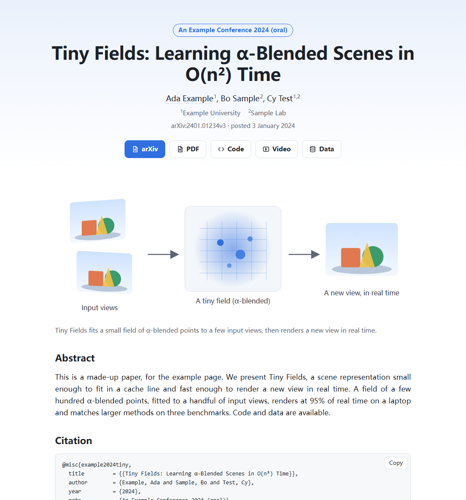

<div align="center">

# paper-page

**A project page for your paper from its arXiv ID.** Title, authors, venue, links, teaser figure, abstract and a
BibTeX block with a copy button, plus the meta tags Google Scholar indexes and the Open Graph tags link previews read.
One static HTML file, light and dark, readable on a phone, ready for GitHub Pages.

<a href="https://github.com/zch6a/paper-page/actions/workflows/ci.yml"></a>


<a href="LICENSE"></a>

**English** · [简体中文](README.zh-CN.md)

</div>

---

<p align="center"></p>
<p align="center"><sub>The <a href="examples/tiny-fields">example</a>, a made-up paper, <b><a href="https://zch6a.github.io/paper-page/">live on GitHub Pages</a></b> (published by the workflow below). Its <a href="docs/example-dark.png">dark version</a>.</sub></p>

The usual way to make a project page is to copy a template repository and fill in every name, link and figure by
hand, and the best-known template is no longer maintained. Everything a project page starts from is already on arXiv:
paper-page reads it and writes the page, and a JSON file you can edit for the rest.

```bash
uvx --from git+https://github.com/zch6a/paper-page paper-page new 2003.08934 -o page/
```

```
paper-page: NeRF: Representing Scenes as Neural Radiance Fields for View Synthesis
  6 author(s), from arXiv:2003.08934v2; venue: ECCV 2020 (oral)
  links: arXiv, PDF, Project page
  figures: 4 taken, 3 of them converted from PDF with pdftoppm (teaser: figures/fig-1.png)
```

## What it takes from arXiv

- **Title, authors, abstract**, with simple TeX math as text (`$O(n^2)$` → O(n²), `\alpha` → α); affiliations when
  arXiv has them.
- **The venue**, when arXiv's comment names it plainly ("ECCV 2020 (oral)", "Accepted to ICLR 2024"); never guessed.
- **Links**: arXiv, PDF and DOI, plus the code, video, data and project page links found in the abstract and comment,
  labelled by the words before them ("our code is at ...") or where they go (GitHub → Code, YouTube → Video).
- **Figures** from the paper's source: the first figure is the teaser, the next ones follow, each with its caption
  (the paper's own simple macros expanded, citations left out). PNG, JPEG, GIF, WebP and SVG are copied as they are;
  **PDF figures are converted** (first page, 1600 pixels wide; a photo-heavy one as JPEG when smaller) when poppler's
  `pdftoppm` is installed, which MiKTeX includes; without it they are listed for you to convert. When the first figure
  cannot be shown, the page has no teaser rather than a later figure in its place.
- **BibTeX**: arXiv's fields (eprint, archivePrefix, primaryClass), the title's capitals protected.
- **For search and sharing**: `citation_title`, `citation_author`, `citation_publication_date`, `citation_arxiv_id`,
  `citation_pdf_url` (what Google Scholar reads); `og:title`, `og:description` and, with `site_url` set, `og:image`
  (the teaser in link previews).

## Then make it yours

`page/page.json` holds everything on the page. Add author homepages and affiliations, a video or data link, the
venue, more figures (`{"src": "figures/x.png", "caption": "..."}`), the accent color, `site_url`. Then:

```bash
paper-page render page/
```

`new` never overwrites an existing `page.json` (your edits are in it); `--force` starts over (and clears the
`figures/fig-N` files it made before; other files there are yours and stay). Before the paper is on
arXiv: `paper-page new --tex paper/main.tex -o page/` reads the title, authors, abstract and figures from your TeX.

| Option | |
|---|---|
| `-o DIR` | the page's folder (default `page/`) |
| `--figures N` | take up to N figures (default 4; `0` fetches no source at all) |
| `--tex FILE` | from a TeX project instead of arXiv |
| `--no-convert` | leave PDF figures out instead of converting them with `pdftoppm` |
| `--force` | replace an existing `page.json` |

## Publish it

Simplest: write the page into `docs/` (`-o docs/`), commit, and choose **Settings → Pages → Deploy from a branch →
main /docs**. Or keep it in `page/` and publish it with a workflow:

```yaml
# .github/workflows/page.yml
name: Project page
on:
  push: { branches: [main], paths: ["page/**"] }
  workflow_dispatch:
permissions:
  contents: read
jobs:
  deploy:
    runs-on: ubuntu-latest
    permissions: { pages: write, id-token: write }
    environment: { name: github-pages, url: "${{ steps.deployment.outputs.page_url }}" }
    steps:
      - uses: actions/checkout@3d3c42e5aac5ba805825da76410c181273ba90b1 # v7.0.1
        with: { persist-credentials: false }
      - uses: actions/upload-pages-artifact@fc324d3547104276b827a68afc52ff2a11cc49c9 # v5.0.0
        with: { path: page }
      - id: deployment
        uses: actions/deploy-pages@368f82528645a54fb793d4d04e342629a3f51346 # v5.0.1
```

(Settings → Pages → Source: GitHub Actions.) The page needs no build step: the workflow only publishes the folder.

## Privacy and safety

paper-page talks to arXiv only (`export.arxiv.org` for the metadata, `arxiv.org/e-print` for the source), one request
every three seconds as arXiv asks, with a User-Agent naming the tool. The source is read in memory and never
extracted: only the chosen images are written, under names it makes (`figures/fig-1.png`). A PDF figure is converted
by running `pdftoppm` (no shell, a time limit, a temporary folder removed after). The page loads nothing
from anywhere else; every text is escaped, links must be http(s), and its Content-Security-Policy lets only its own
copy-button script run. See [SECURITY.md](SECURITY.md).

## Also in this toolkit

[paper-proof](https://github.com/zch6a/paper-proof) checks references and numbers ·
[submit-check](https://github.com/zch6a/submit-check) checks a submission against the venue's rules ·
[arxiv-diff](https://github.com/zch6a/arxiv-diff) shows what changed between arXiv versions ·
[exp-tables](https://github.com/zch6a/exp-tables) makes results tables with significance ·
[scholar-cards](https://github.com/zch6a/scholar-cards) puts your citations on your homepage ·
[paper-impact](https://github.com/zch6a/paper-impact) shows which papers at AI venues mattered.

## License

MIT. The pages it makes are yours; the figures in them are the paper's.
