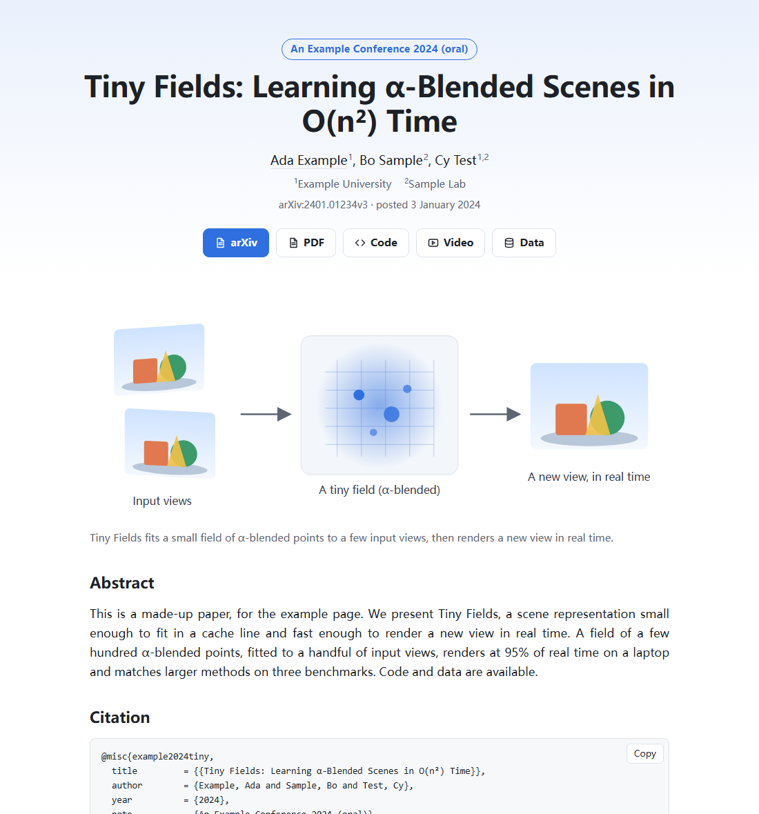

<div align="center">

# paper-page

**输入 arXiv 编号，生成论文项目主页。** 标题、作者、会议、链接按钮、预览图、摘要和一键复制的 BibTeX，再加上
Google Scholar 收录用的 meta 标签和链接预览用的 Open Graph 标签。只有一个静态 HTML 文件，支持浅色/深色，手机上也好读，直接放到 GitHub Pages。

<a href="https://github.com/zch6a/paper-page/actions/workflows/ci.yml"></a>


<a href="LICENSE"></a>

[English](README.md) · **简体中文**

</div>

---

<p align="center"></p>
<p align="center"><sub><a href="examples/tiny-fields">示例</a>是一篇虚构的论文，<b><a href="https://zch6a.github.io/paper-page/">已发布在 GitHub Pages 上</a></b>（用的就是下面的发布工作流）。另见<a href="docs/example-dark.png">深色版</a>。</sub></p>

做项目主页通常要复制一个模板仓库，把每个名字、链接、图片手工填进去，而最有名的那个模板已经不再维护。项目主页需要的东西 arXiv 上都有：
paper-page 读出来直接生成页面，剩下的写在一个可以编辑的 JSON 文件里。

```bash
uvx --from git+https://github.com/zch6a/paper-page paper-page new 2003.08934 -o page/
```

## 从 arXiv 取什么

- **标题、作者、摘要**，简单的 TeX 公式转成文字（`$O(n^2)$` → O(n²)，`\alpha` → α）；arXiv 有单位信息时一并取出。
- **会议**：只有 arXiv 的 comment 明确写出时才填（“ECCV 2020 (oral)”“Accepted to ICLR 2024”），从不猜。
- **链接**：arXiv、PDF、DOI，以及摘要和 comment 里出现的代码、视频、数据、项目主页链接，按链接前面的词（“our code is at ...”）或网址（GitHub → Code，YouTube → Video）命名。
- **图**：从论文源码里取，第一张图作预览图，后面的依次排列，各带图注（论文自定义的简单宏会展开，引用标记去掉；由多个子图组成的图显示第一个子图和整张图自己的图注；同名的 PDF 与 PNG 都有时取论文实际印出的 PDF）。PNG、JPEG、GIF、WebP、SVG 原样复制；
  装有 poppler 的 `pdftoppm` 时（MiKTeX 自带）**PDF 图会自动转换**（第一页，宽 1600 像素；照片多的图在更小时存成 JPEG），没有则列出来请你转换。
  第一张图无法显示时页面就不放预览图，不会拿后面的图顶替。
- **BibTeX**：arXiv 的字段（eprint、archivePrefix、primaryClass），标题大小写加花括号保护。
- **搜索与分享**：`citation_title`、`citation_author`、`citation_publication_date`、`citation_arxiv_id`、`citation_pdf_url`（Google Scholar 读这些）；
  `og:title`、`og:description`，设置了 `site_url` 时还有 `og:image`（链接预览里显示预览图）。

## 再改成你想要的样子

页面上的一切都在 `page/page.json` 里：作者主页和单位、视频或数据链接、会议、更多的图（`{"src": "figures/x.png", "caption": "..."}`）、主题色、`site_url`。改完运行：

```bash
paper-page render page/
```

`new` 不会覆盖已有的 `page.json`（你的修改在里面），`--force` 才重新开始（并清掉它之前生成的 `figures/fig-N` 文件，那里你自己的文件不动）。论文还没上 arXiv 时：`paper-page new --tex paper/main.tex -o page/`
从你的 TeX 读标题、作者、摘要和图。

| 选项 | |
|---|---|
| `-o DIR` | 页面所在文件夹（默认 `page/`） |
| `--figures N` | 最多取 N 张图（默认 4；`0` 则完全不下载源码） |
| `--tex FILE` | 从 TeX 工程生成，而不是 arXiv |
| `--no-convert` | 不用 `pdftoppm` 转换 PDF 图，直接略过 |
| `--force` | 覆盖已有的 `page.json` |

## 发布

最简单的做法：把页面写到 `docs/`（`-o docs/`），提交，然后在 **Settings → Pages → Deploy from a branch → main /docs** 选中即可。
也可以放在 `page/` 里用工作流发布，配置见[英文 README](README.md#publish-it)（页面不需要构建，工作流只负责发布这个文件夹）。

## 隐私与安全

paper-page 只访问 arXiv（元数据走 `export.arxiv.org`，源码走 `arxiv.org/e-print`），按 arXiv 的要求每三秒最多一次请求，User-Agent 只写工具名。
源码只在内存里读取，从不解压到磁盘：只写出选中的图片，文件名由工具生成（`figures/fig-1.png`）。PDF 图通过运行 `pdftoppm` 转换（不经过 shell，有时间限制，临时文件夹用完即删）。生成的页面不从任何别的地方加载资源；
所有文字都经过转义，链接只允许 http(s)，页面的内容安全策略（CSP）只允许它自己的复制按钮脚本运行。详见 [SECURITY.md](SECURITY.md)。

## 属于 research-kit

这是 13 个开源科研工具之一，覆盖从读论文到论文发表之后。全部工具按科研流程的介绍，以及安装它们技能的 Claude Code 插件市场，见 [research-kit](https://github.com/zch6a/research-kit) · [网站](https://zch6a.github.io/research-kit/)。

## 许可证

MIT。生成的页面归你；页面里的图属于论文作者。
